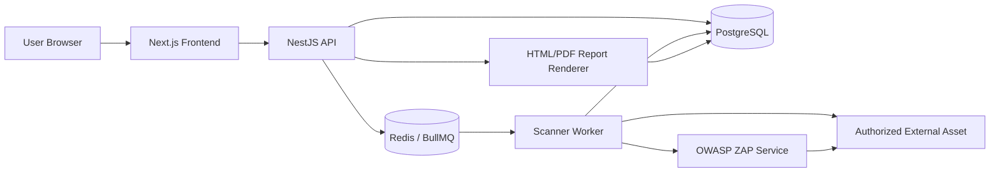
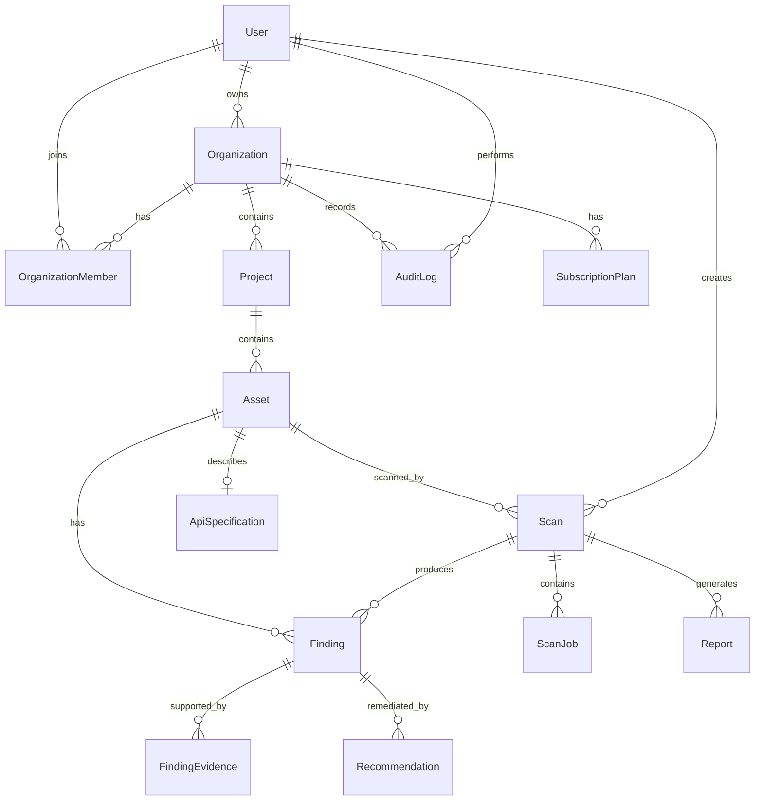
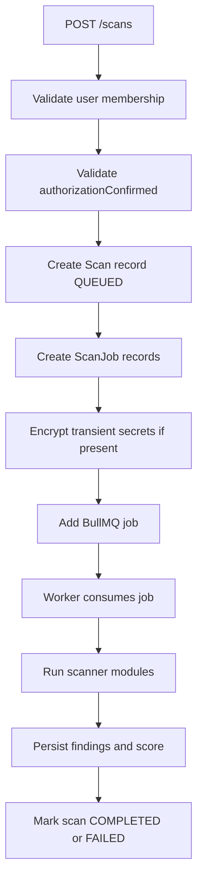
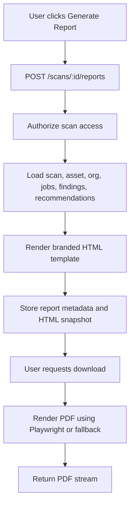
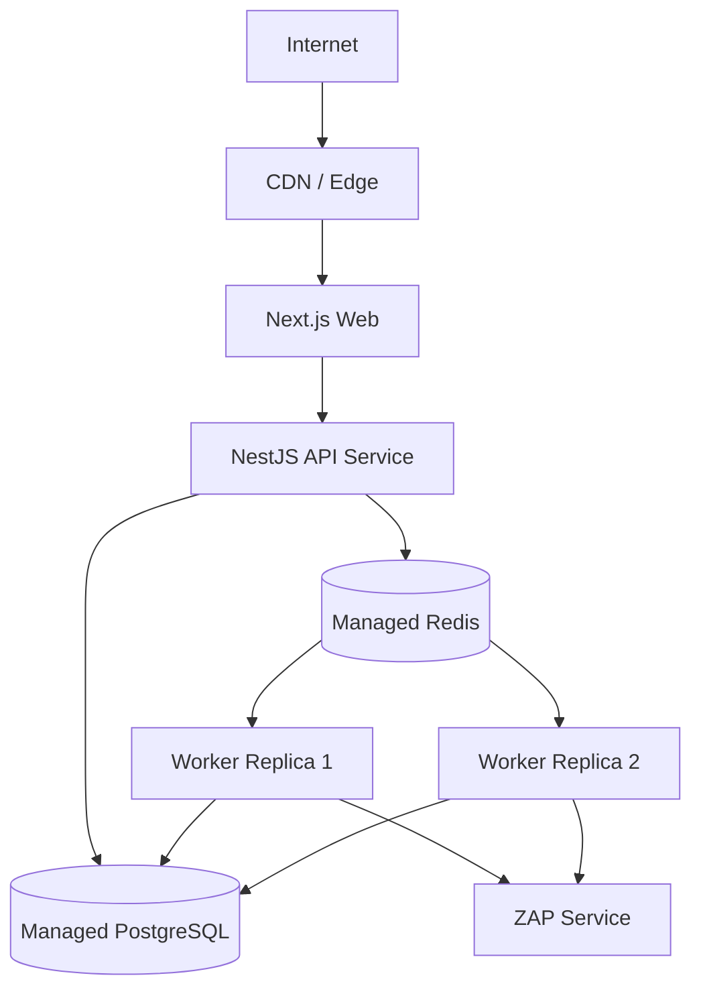
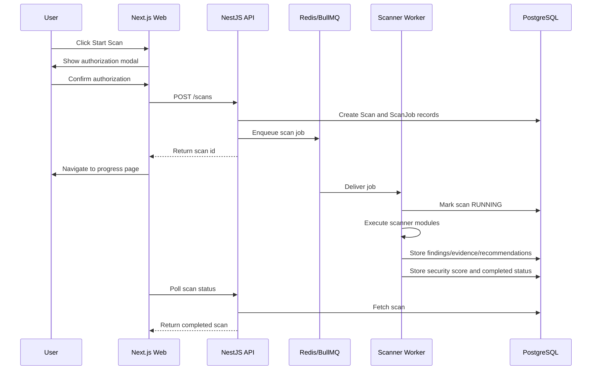
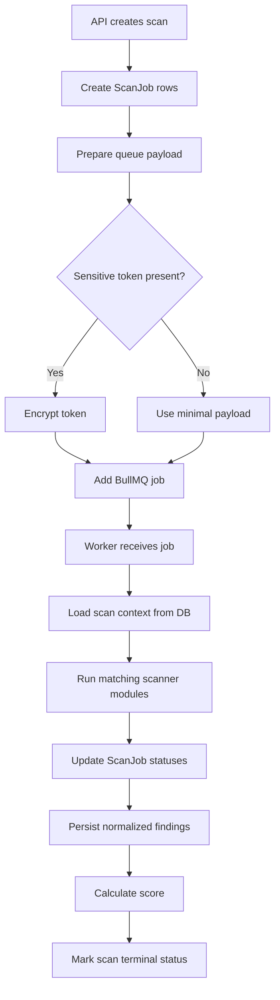

# LuminarIQ SecureScan Software Design Document

## 1. Introduction

LuminarIQ SecureScan is a defensive security audit SaaS platform for websites, web applications, APIs, and source code repositories. The system provides authenticated workspaces, asset management, asynchronous scan orchestration, scanner workers, normalized security findings, severity scoring, remediation guidance, dashboards, and professional report generation.

This Software Design Document describes the technical architecture, components, data model, queue design, security controls, and scalability considerations for the MVP and near-term roadmap.

## 2. Purpose

The purpose of this document is to:

- Define the software architecture for LuminarIQ SecureScan.
- Establish clear boundaries between frontend, backend, worker, database, and scanner modules.
- Document design decisions for security, multi-tenancy, scanning safety, reporting, and extensibility.
- Provide a reference for implementation, testing, deployment, and future scaling.

## 3. Scope

This document covers:

- Next.js frontend architecture.
- NestJS API architecture.
- PostgreSQL and Prisma data model.
- Redis/BullMQ queue orchestration.
- Scanner worker architecture.
- Website, API, ZAP, and repository scanner module design.
- Findings normalization and severity scoring.
- Template-based remediation engine.
- Report generation.
- Authentication and authorization.
- Multi-tenancy.
- SSRF protection and secrets handling.
- CI/CD and testing design.

Out of scope:

- Full production infrastructure runbook.
- Billing provider implementation.
- Enterprise SSO implementation.
- External AI provider implementation details.
- Deep active penetration testing design.

## 4. Technology Stack

| Layer | Technology |
| --- | --- |
| Frontend | Next.js, React, Tailwind CSS, Playwright |
| Backend API | NestJS, TypeScript |
| ORM | Prisma |
| Database | PostgreSQL |
| Queue | Redis, BullMQ |
| Worker | Node.js TypeScript worker |
| Scanner Integration | Internal scanner modules, OWASP ZAP passive baseline |
| Reports | HTML templates, Playwright/PDF renderer fallback |
| Auth | JWT, bcrypt password hashing |
| Validation | class-validator DTOs, Zod on frontend |
| Testing | Vitest, Playwright |
| Deployment | Docker, Docker Compose for local services |

## 5. High-Level Architecture

LuminarIQ SecureScan uses a modular SaaS architecture:

- The Next.js frontend handles user workflows and calls the backend API.
- The NestJS backend owns authentication, authorization, CRUD operations, scan creation, findings APIs, and report APIs.
- PostgreSQL stores tenant, asset, scan, finding, report, and audit data.
- Redis/BullMQ stores asynchronous scan jobs.
- Scanner workers consume queue jobs and execute safe defensive checks.
- OWASP ZAP can run as a separate Docker service for passive baseline scans.



## 6. Component Architecture

| Component | Responsibility |
| --- | --- |
| Web App | UI, forms, protected routes, dashboard, scan/finding/report pages |
| API App | Auth, tenancy enforcement, domain services, DTO validation, scan creation |
| Prisma Layer | Database access and relational mapping |
| Redis/BullMQ | Asynchronous scan job queue |
| Scanner Worker | Executes scan jobs and stores findings |
| Scanner Modules | Individual defensive checks |
| Findings Engine | Normalization, deduplication, status defaults, retest logic |
| Severity Engine | Severity mapping and security score calculation |
| Recommendation Engine | Template-based remediation guidance |
| Report Service | HTML/PDF report generation and download |
| Audit Logging | Records key security and workspace actions |

## 7. Frontend Architecture

The frontend is a Next.js application using App Router pages. It provides protected workspace flows after login.

Primary frontend responsibilities:

- Login and registration forms.
- Protected shell and navigation.
- Dashboard summary cards and charts.
- Organization/project/asset views.
- Scan confirmation modal.
- Scan progress and scan history.
- Scan results filtering.
- Finding detail and status updates.
- Report generation and download.

Frontend design principles:

- Use Zod for form validation where applicable.
- Keep API access centralized in `lib/api`.
- Store JWT in local storage for MVP.
- Redirect unauthenticated users to `/login`.
- Show loading, empty, and error states.
- Keep security evidence readable and redacted.

Key routes:

- `/login`
- `/register`
- `/dashboard`
- `/organizations`
- `/projects`
- `/projects/[id]`
- `/assets/new`
- `/assets/[id]`
- `/scans`
- `/scans/[id]`
- `/scans/[id]/progress`
- `/findings/[id]`
- `/reports`
- `/repository-findings`

## 8. Backend Architecture

The backend is a NestJS API organized by domain modules.

Primary modules:

- AuthModule
- OrganizationsModule
- ProjectsModule
- AssetsModule
- ScansModule
- FindingsModule
- ReportsModule
- AuditModule
- AdminModule placeholder

Backend patterns:

- Controllers expose HTTP endpoints.
- DTOs validate request input.
- Services implement business rules.
- Repositories encapsulate Prisma queries.
- Guards enforce JWT authentication.
- Services enforce tenant membership through repository queries.

API responsibilities:

- Authenticate users.
- Enforce organization membership.
- Validate scan requests and authorization confirmation.
- Create scan and scan job records.
- Enqueue worker jobs.
- Serve scan, finding, and report data.
- Generate reports.
- Write audit logs.

## 9. Worker Architecture

The scanner worker is a separate Node.js TypeScript process.

Responsibilities:

- Consume BullMQ scan jobs.
- Load scan, asset, scan jobs, and API spec context.
- Mark scan/job status transitions.
- Dispatch scanner modules based on scan jobs.
- Isolate failures per scanner module.
- Normalize and deduplicate findings.
- Store findings, evidence, and recommendations.
- Calculate security score.
- Mark resolved previous findings as fixed when appropriate.

Worker design principles:

- Scanners are defensive and non-invasive.
- Scanner failures should not crash the worker.
- Logs are structured JSON.
- External command execution is wrapped and testable.
- Temporary repository scan workspaces are cleaned up.

## 10. Database Design

The database is PostgreSQL accessed through Prisma.

Core tables:

- User
- Organization
- OrganizationMember
- Project
- Asset
- ApiSpecification
- Scan
- ScanJob
- Finding
- FindingEvidence
- Recommendation
- Report
- AuditLog
- SubscriptionPlan



Database design principles:

- Use UUID primary keys.
- Keep tenant access anchored through organization membership.
- Store structured scanner data in JSON fields where appropriate.
- Do not store plaintext secrets.
- Preserve evidence and report snapshots for auditability.

## 11. Queue Design

Redis and BullMQ provide asynchronous scan orchestration.

Queue name:

- `website-scans`

Job payload:

- `scanId`
- Optional API bearer token for one-time scan use.
- Optional API scan scope paths.
- Optional encrypted repository token payload.
- Optional repository branch.
- Optional repository ZIP payload.

Queue design considerations:

- Scan records are created before queue enqueue.
- If enqueue fails, scan is marked as queue failure.
- Worker uses concurrency configuration.
- Queue payloads should avoid plaintext secrets.
- Long-running scanner work is isolated from API request latency.



## 12. Scanner Module Design

Scanner modules implement a common interface:

- `jobType`
- `run(target, context)`

Website baseline modules:

- HTTPS check
- Security headers check
- Cookie security check
- Exposed sensitive files check
- TLS summary check
- OWASP ZAP passive baseline scan

API baseline modules:

- OpenAPI specification check
- Safe API endpoint checks

Repository modules:

- Gitleaks output parsing
- Semgrep output parsing
- Trivy output parsing
- npm audit parsing
- Built-in environment file checks
- Weak crypto pattern checks
- Insecure configuration checks
- CI/CD secret leakage checks

Scanner safety rules:

- No destructive HTTP methods in MVP.
- Prefer HEAD where appropriate.
- Limit response body size.
- Apply timeouts.
- Do not brute force.
- Do not aggressively crawl.
- Block private/internal targets by default.

## 13. Findings Engine Design

The findings engine transforms raw scanner observations into normalized user-facing findings.

Responsibilities:

- Standardize title, description, severity, category, evidence, impact, and remediation.
- Map findings to OWASP categories.
- Add default status `OPEN`.
- Deduplicate repeated findings.
- Create finding evidence and recommendation records.
- Support retest behavior across scans.

Deduplication key should consider:

- Scan ID
- Asset ID
- Finding title
- Affected URL
- Evidence summary or normalized evidence fingerprint

Retest support:

- If a previous open finding is no longer detected in a later scan, mark it `FIXED`.
- Findings marked false positive or risk accepted should follow explicit product policy before automatic changes.

## 14. Severity Scoring Design

Severity levels:

- Critical
- High
- Medium
- Low
- Info

Security score formula:

- Start at 100.
- Critical: minus 25 each.
- High: minus 12 each.
- Medium: minus 6 each.
- Low: minus 2 each.
- Info: minus 0.5 each.
- Minimum score: 0.

Score summary includes:

- `criticalCount`
- `highCount`
- `mediumCount`
- `lowCount`
- `infoCount`
- `totalFindings`
- `riskTrend` placeholder

Severity factors:

- Internet-facing exposure.
- Sensitive data exposure.
- Authentication/session impact.
- Ease of exploitation.
- Business impact.
- Known vulnerability indicator.
- Misconfiguration type.
- Compliance impact.

## 15. Recommendation Engine Design

The MVP uses a template-based remediation engine.

Inputs:

- Finding title/type.
- Severity.
- Category.
- Evidence.
- Affected URL.
- Scanner context.

Outputs:

- Plain-English explanation.
- Business impact.
- Technical impact.
- Recommended fix.
- Code/config examples.
- Retest steps.
- Priority guidance.

Supported examples:

- Missing HTTPS.
- Missing HSTS.
- Missing CSP.
- Cookie missing Secure/HttpOnly/SameSite.
- Expired TLS certificate.
- Exposed `.env`.
- Exposed `.git`.
- Server information disclosure.
- Repository security observations.

Future AI provider mode:

- Use an interface such as `generateRecommendation(findingContext)`.
- Apply guardrails.
- Cite scanner evidence.
- Do not generate offensive payloads or bypass instructions.

## 16. Report Generation Design

Reports are generated from HTML templates and rendered to PDF.

Report types:

- Executive Summary Report.
- Technical Findings Report.
- Full Security Audit Report.

Report flow:



Report requirements:

- Branded header/footer.
- Defensive authorized scan disclaimer.
- Severity legend.
- Security score explanation.
- Executive and technical sections.
- Evidence and recommendations.
- Glossary for full reports.

## 17. Authentication and Authorization Design

Authentication:

- Email/password login.
- bcrypt password hashing.
- JWT issued on register/login.
- JWT secret from environment.
- `/auth/me` returns current user profile.

Authorization:

- JWT guard protects workspace routes.
- Services use user ID to scope database queries.
- Organization membership determines access.
- Cross-tenant access returns not found or forbidden.

Frontend:

- Stores JWT in local storage for MVP.
- Protected shell redirects unauthenticated users to login.

Future improvements:

- Refresh tokens or secure HTTP-only cookies.
- SSO/SAML.
- Fine-grained RBAC.

## 18. Multi-Tenancy Design

Tenant boundary:

- Organization is the tenant boundary.

Membership:

- Users access data through `OrganizationMember`.
- Roles include OWNER, ADMIN, MEMBER, VIEWER.

Data access:

- Projects belong to organizations.
- Assets belong to projects.
- Scans and findings belong to assets.
- Reports belong to scans.
- Queries should enforce access through organization membership.

Security principle:

- Never trust client-provided organization IDs alone.
- Always join through membership for user-scoped reads and writes.

## 19. API Design

Core endpoints:

- `POST /auth/register`
- `POST /auth/login`
- `GET /auth/me`
- `POST /organizations`
- `GET /organizations`
- `GET /organizations/:id`
- `POST /projects`
- `GET /projects`
- `GET /projects/:id`
- `POST /assets`
- `GET /assets`
- `GET /assets/:id`
- `POST /scans`
- `GET /scans`
- `GET /scans/:id`
- `GET /findings`
- `GET /findings/:id`
- `PATCH /findings/:id/status`
- `POST /scans/:id/reports`
- `GET /reports`
- `GET /reports/:id`
- `GET /reports/:id/download`

API design principles:

- Validate all inputs with DTOs.
- Use consistent JSON responses.
- Return safe error messages.
- Do not expose internal stack traces.
- Do not expose secrets.

## 20. Error Handling

Error categories:

- Validation errors.
- Authentication errors.
- Authorization/not found errors.
- Queue unavailable errors.
- Scanner module errors.
- Report generation errors.
- Database errors.

Design:

- Controllers rely on NestJS exceptions.
- Services throw domain-appropriate exceptions.
- Worker catches module-level exceptions and marks job failed.
- Scan can continue if individual checks fail.
- UI displays user-safe error states.

## 21. Logging and Monitoring

Current logging:

- API uses NestJS logging.
- Worker emits structured JSON logs for scan lifecycle events.

Recommended log events:

- User registration.
- Login success/failure metadata without secrets.
- Organization/project/asset creation.
- Scan queued/running/completed/failed.
- Scan job started/completed/failed.
- Report generated/downloaded.
- Security validation failures.

Future monitoring:

- API health check.
- Worker health check.
- Queue depth metrics.
- Scan duration metrics.
- Error rate dashboards.
- Alerting for queue failures and worker crashes.

## 22. Security Controls

Implemented or required controls:

- Password hashing.
- JWT auth.
- Environment-based secrets.
- DTO validation.
- Organization membership checks.
- Helmet middleware.
- CORS configuration.
- Auth rate limiting placeholder/enforcement.
- SSRF protection.
- Private IP blocking.
- Secret redaction.
- Repository token encryption for queue payloads.
- Non-invasive scanner policy.
- Audit logging.

## 23. SSRF Protection

SSRF protection applies to scanner targets and OpenAPI spec URLs.

Default blocked targets:

- `localhost`
- `127.0.0.1`
- `::1`
- Metadata IPs such as `169.254.169.254`
- Private IPv4 ranges.
- Private/internal IPv6 ranges where applicable.

Design:

- Validate URL protocol.
- Resolve/inspect host where possible.
- Block private networks by default.
- Allow private network scanning only through explicit admin-controlled configuration.
- Prevent redirects to blocked destinations.

## 24. Rate Limiting

Initial rate limiting focus:

- `POST /auth/register`
- `POST /auth/login`

Design:

- Apply auth route guard/middleware.
- Track attempts by IP and/or email.
- Return 429 when threshold exceeded.
- Do not reveal account existence.

Future:

- Per-tenant scan creation limits.
- Report generation throttles.
- API global request limits.

## 25. Secrets Handling

Secrets include:

- User passwords.
- JWT secret.
- Repository tokens.
- API bearer tokens.
- Scanner-discovered credentials.

Rules:

- Passwords stored only as hashes.
- JWT secret comes from environment.
- Repository token is encrypted before queue storage and decrypted only in worker memory.
- API bearer token is passed transiently for scans and not stored in scan summary.
- Scanner evidence must redact secret values.
- Reports must not include full secret values.
- Logs must not include tokens or credentials.

## 26. File Storage

MVP storage:

- Reports store metadata and HTML snapshot in the database.
- PDF can be rendered on demand for download.
- Repository ZIP upload is passed for scan processing and extracted into a temporary worker workspace.
- Temporary repository workspaces are deleted after scan completion or failure.

Future storage:

- Object storage for generated PDFs.
- Retention policy for reports.
- Virus/malware scanning for uploads if file upload support expands.
- Signed URLs for downloads.

## 27. Deployment Architecture

Local deployment:

- Docker Compose for PostgreSQL, Redis, and OWASP ZAP.
- API runs as NestJS process.
- Web runs as Next.js process.
- Worker runs as Node.js process.

Production target:

- Web app deployed as container or managed Next.js service.
- API deployed as horizontally scalable containers.
- Worker deployed as independent scalable worker pool.
- Managed PostgreSQL.
- Managed Redis.
- Optional isolated ZAP service.
- Centralized logging and monitoring.



## 28. CI/CD Design

Pull request pipeline:

1. Checkout code.
2. Setup Node and pnpm.
3. Install dependencies.
4. Generate Prisma client.
5. Run TypeScript checks.
6. Run unit tests.
7. Build API, web, worker, shared packages.
8. Start PostgreSQL and Redis test services.
9. Run integration tests.
10. Run Playwright E2E tests.
11. Upload test artifacts.

Recommended commands:

```bash
corepack pnpm lint
corepack pnpm test
corepack pnpm build
corepack pnpm --filter @luminar-iq/api test:integration
corepack pnpm --filter @luminar-iq/web test:e2e
```

Release pipeline:

- Run full PR pipeline.
- Run security test suite.
- Run performance smoke tests.
- Generate sample reports.
- Archive coverage and Playwright traces.

## 29. Testing Strategy

Testing layers:

- Unit tests for services, scanner modules, scoring, recommendations, reports.
- Controller tests with mocked services.
- Integration tests with PostgreSQL and Redis.
- Worker dispatcher tests with mocked scanner modules.
- Playwright E2E tests with mocked API responses.
- Security tests for auth, tenant isolation, SSRF, and masking.

Current test tooling:

- Vitest for API, worker, shared, and web unit tests.
- Playwright for E2E.
- Prisma integration tests gated by `TEST_DATABASE_URL`.

Quality gates:

- P0 unit tests pass.
- API/web/worker build passes.
- E2E critical flows pass.
- No Critical security defects open.

## 30. Future Scalability Considerations

Application scaling:

- Scale API containers horizontally.
- Scale worker replicas independently by queue depth.
- Use separate queues per scan type if throughput grows.
- Add scan priority tiers based on subscription plan.

Database scaling:

- Add indexes for organization membership, asset scans, finding severity/status, report lookups.
- Archive old scan/finding records.
- Use read replicas for dashboards and reports if needed.

Queue scaling:

- Add dead-letter queues.
- Add retry policies.
- Add job timeout policies per scan type.
- Track queue depth and worker lag.

Scanner scaling:

- Isolate high-cost scanners.
- Rate-limit outbound requests.
- Add per-tenant concurrency limits.
- Use sandboxed execution environments for repository scanning.

Report scaling:

- Generate PDFs asynchronously for large reports.
- Store generated PDFs in object storage.
- Cache report snapshots.

AI scaling:

- Keep deterministic templates as fallback.
- Add provider abstraction for AI output.
- Enforce prompt guardrails.
- Add confidence and evidence citation fields.

## Appendix: Scan Workflow Diagram



## Appendix: Worker Queue Flow Diagram



